# Занятие 1. Создаём базу данных «Органическая химия»

## Что получится

Создадим в PostgreSQL базу `organic_chemistry` и таблицу `public.alkanes`, затем внесём десять алканов. Работаем в pgAdmin. Python пока не нужен.

Весь курс: **[1. База и данные](01_sql_sozdanie_bazy.md) → [2. Запросы и Python](02_zaprosy_i_python.md) → [3. Окно вручную](03_tkinter_vruchnuyu.md) → [4. Окно и БД](04_tkinter_postgresql.md)**.

Понадобятся установленный и запущенный сервер PostgreSQL, pgAdmin и пароль пользователя сервера. pgAdmin — программа управления; сами данные хранит PostgreSQL.

## Как работать на занятиях

Не набирайте весь документ сразу. На каждом шаге:

1. Сформулируйте своими словами, что должно измениться.
2. Напишите небольшой фрагмент в указанном месте.
3. Запустите его и сравните результат с проверкой.
4. Выполните мини-задание и объясните результат.

SQL пишем в **Query Tool**, команды установки — в **терминале**, Python — в файлах `.py`. Это три разных места работы.

## Шаг 1. Данные

Тема — органическая химия, раздел «Алканы». В учебном каталоге храним первые десять представителей неразветвлённого ряда. Для пентана и следующих названия подразумевают нормальную, то есть неразветвлённую, цепь. Изомеры в этот каталог пока не включаем.

Ровно три столбца:

- `name` — название, например `Метан`; тип `TEXT`.
- `formula` — молекулярная формула, например `CH4`; тип `TEXT`.
- `carbon_count` — число атомов углерода, например `1`; тип `INTEGER`.

Для этих алканов общая формула — CₙH₂ₙ₊₂. В БД используем обычные цифры: `C2H6`, без нижних индексов. В `CH4` единица после C не пишется.

**Почему нет `id`?** Требуется ровно три столбца. В нашем небольшом каталоге уникальным ключом будет название. Это учебное решение: при расширении каталога структуру можно изменить. Формула не подходит как уникальный ключ для каталога с изомерами.

**Подумайте:** почему число атомов хранится числом, а формула — текстом? Ответ: число нужно сравнивать и сортировать как число; формула содержит буквы.

## Шаг 2. Создайте базу SQL-командой

В pgAdmin раскройте **Servers → ваш сервер → Databases**. Если сервер просит пароль, введите пароль своего пользователя PostgreSQL.

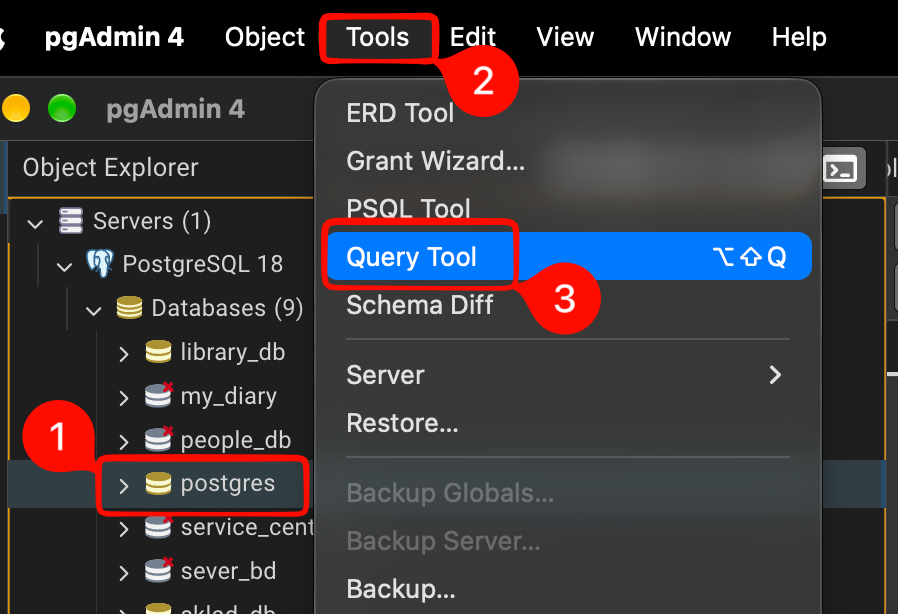

1. Выберите существующую служебную базу `postgres`.
2. Откройте **Tools → Query Tool**.
3. Проверьте, что включён **Auto commit**. Не добавляйте `BEGIN`.
4. Напишите и выполните **только эту команду** кнопкой выполнения запроса или F5:

```sql
CREATE DATABASE organic_chemistry;
```

`CREATE DATABASE` означает «создать базу данных», `organic_chemistry` — её техническое имя, `;` завершает команду. Имена пишем латиницей без пробелов, русские названия веществ будут значениями.

**Проверка:** обновите узел **Databases** через **Refresh**. В списке должна появиться `organic_chemistry`.

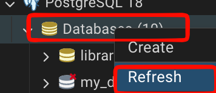

Не запускайте создание повторно: сообщение `already exists` означает, что такая база уже есть. Ничего удалять не нужно.

Если удобнее создавать мышью: **Databases → Create → Database…**, имя `organic_chemistry`, владелец — ваш пользователь, затем **Save**. Это альтернативный способ того же шага, выполнять оба способа не требуется.

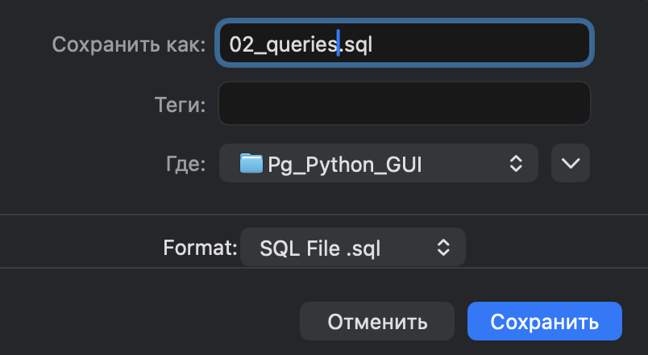

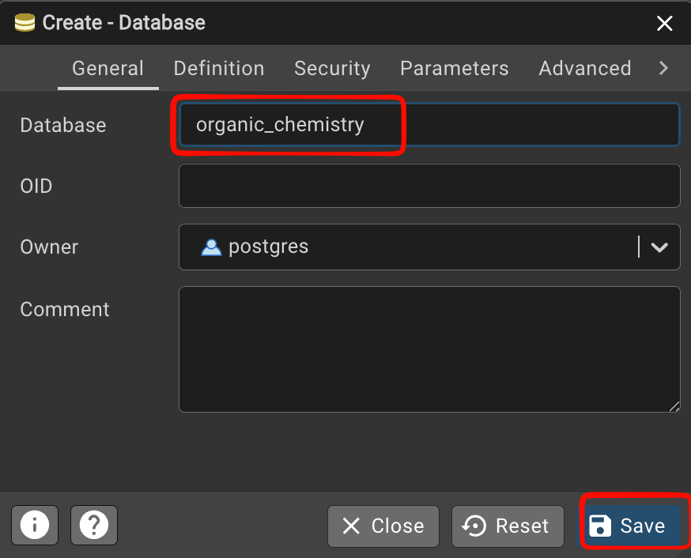

## Шаг 3. Откройте редактор именно новой базы

Закройте или отложите старую вкладку Query Tool. Выберите `organic_chemistry` и откройте для неё новый **Query Tool**.

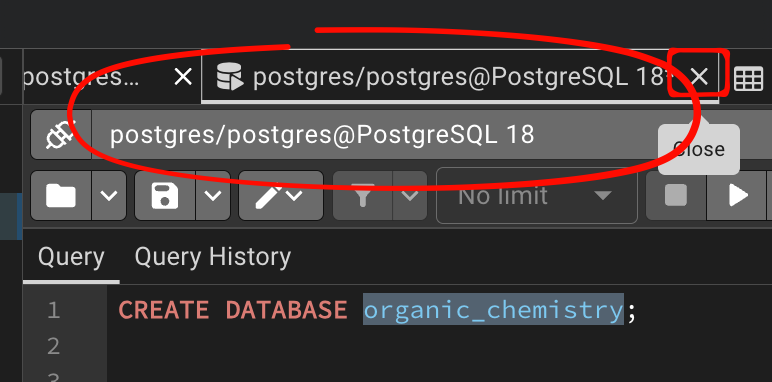

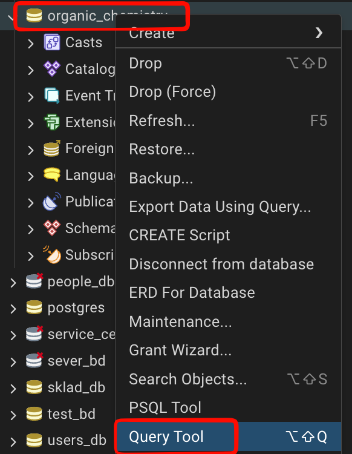

В новом редакторе напишите:

```sql
SELECT current_database();
```

**Проверка:** результат — `organic_chemistry`. Если видите `postgres`, вы открыли редактор другой базы. Создание БД само по себе не переключает подключение.

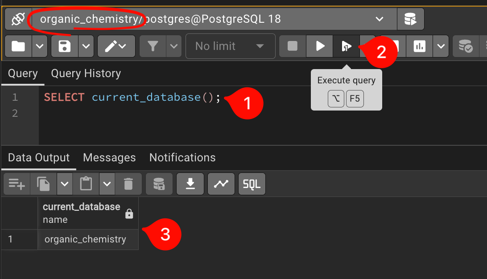

Запрос — инструкция серверу. В этом примере `SELECT` получает значение, а не создаёт объект. Результат виден на вкладке **Data Output**, сообщения о выполнении — в **Messages**.

## Шаг 4. Постройте определение таблицы по частям

Сначала напишите каркас ниже. **Пока не выполняйте:** комментарий обозначает место, которое нужно заполнить.

```sql
CREATE TABLE public.alkanes (
    -- здесь будут определения трёх столбцов
);
```

`public` — схема, то есть пространство имён внутри базы; `alkanes` — имя таблицы. Внутри скобок перечисляются столбцы.

**Вместо комментария** добавьте три строки:

```sql
    name TEXT PRIMARY KEY,
    formula TEXT NOT NULL,
    carbon_count INTEGER NOT NULL CHECK (carbon_count > 0)
```

Обратите внимание на запятые: после первых двух определений они есть, после последнего — нет.

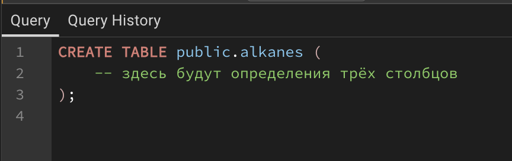

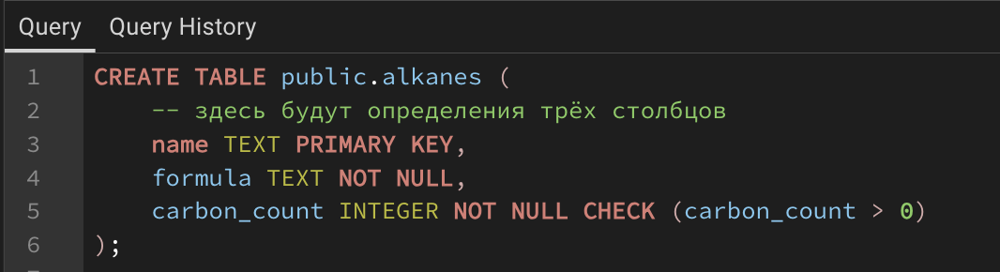

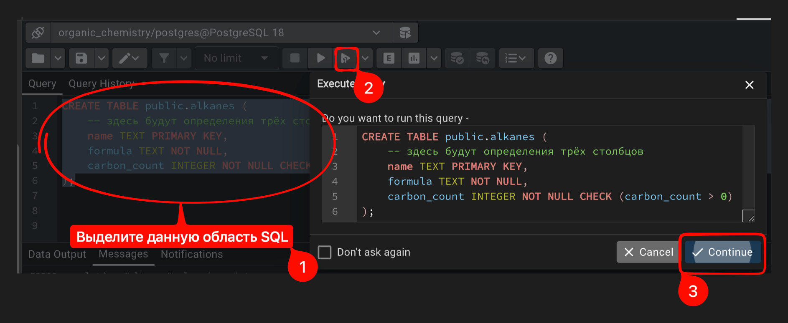


Проверка — отдельным запросом:

```sql
SELECT * FROM public.alkanes;
```

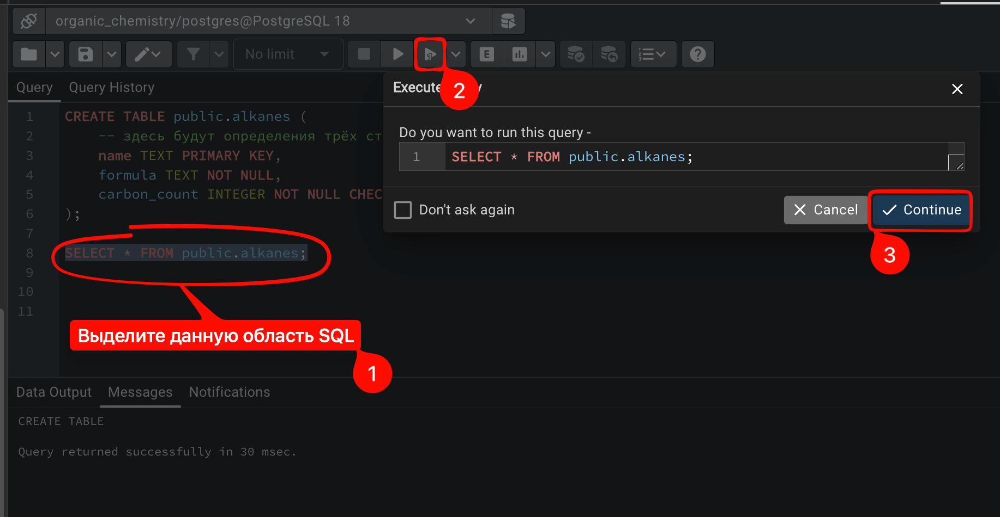

Вы должны увидеть три заголовка и ни одной строки. Пустая таблица уже существует. `*` означает «все столбцы».

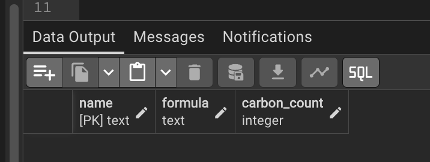

## Шаг 5. Добавьте первую строку

В Query Tool выделите только новый запрос и выполните:

```sql
INSERT INTO public.alkanes (name, formula, carbon_count)
VALUES ('Метан', 'CH4', 1);
```
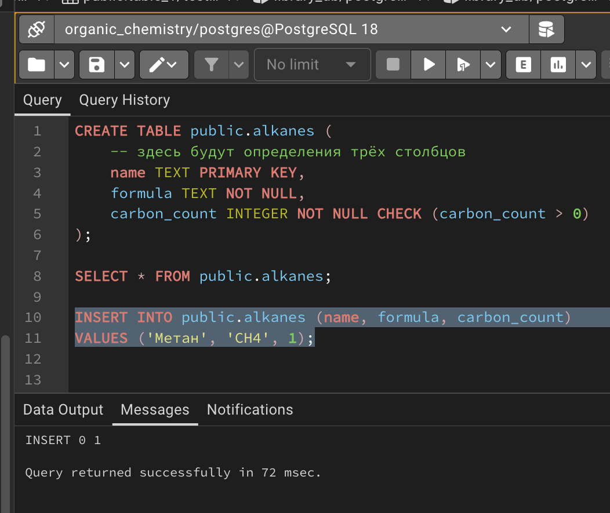

`INSERT INTO` указывает, куда добавить данные. После имени таблицы задан порядок столбцов, а после `VALUES` — значения в этом порядке. Строки заключаем в одинарные кавычки, целое число — без кавычек.

Снова выполните `SELECT * FROM public.alkanes;`.

**Проверка:** одна строка — `Метан`, `CH4`, `1`.

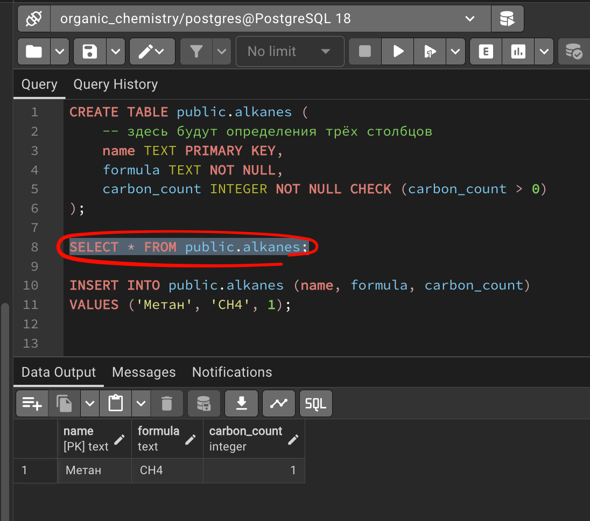

**Мини-задание:** не выполняя вставку, объясните, что не так со значением `0` в третьем столбце. Какое ограничение его отклонит?

## Шаг 6. Дополните каталог ещё девятью строками

Сначала самостоятельно напишите вставку этана: название `Этан`, формула `C2H6`, число атомов `2`. Затем сравните с образцом ниже. Выполните либо свою вставку и оставшиеся восемь строк отдельно, либо весь образец, если свою вставку ещё не запускали.

```sql
INSERT INTO public.alkanes (name, formula, carbon_count)
VALUES
    ('Этан', 'C2H6', 2),
    ('Пропан', 'C3H8', 3),
    ('Бутан', 'C4H10', 4),
    ('Пентан', 'C5H12', 5),
    ('Гексан', 'C6H14', 6),
    ('Гептан', 'C7H16', 7),
    ('Октан', 'C8H18', 8),
    ('Нонан', 'C9H20', 9),
    ('Декан', 'C10H22', 10);
```

В одной команде можно добавить несколько строк: между кортежами стоят запятые, в конце — точка с запятой. Метан сюда не включён: он уже добавлен.

**Проверка:**

```sql
SELECT name, formula, carbon_count
FROM public.alkanes
ORDER BY carbon_count ASC;
```

Ожидаемый результат:

```text
Метан   CH4     1
Этан    C2H6    2
Пропан  C3H8    3
Бутан   C4H10   4
Пентан  C5H12   5
Гексан  C6H14   6
Гептан  C7H16   7
Октан   C8H18   8
Нонан   C9H20   9
Декан   C10H22  10
```

`ORDER BY carbon_count ASC` располагает строки по возрастанию числа атомов. Без `ORDER BY` порядок строк не гарантирован.

## Шаг 7. Проверьте количество и сохраните работу

```sql
SELECT COUNT(*) FROM public.alkanes;
```

Результат — `10`. `COUNT(*)` считает строки.

Сохраните команды создания таблицы и заполнения через **Save** в файл `01_alkanes.sql`. Команду создания базы лучше сохранить отдельно в `00_database.sql`, поскольку она выполняется через другое подключение и отдельно от остальных команд.

SQL-файл хранит текст команд, а не саму базу данных. Сохранение файла не запускает запросы.

## Если что-то пошло не так

- `database ... already exists` — база уже создана; откройте её, не удаляйте.
- `relation ... already exists` — таблица уже есть; проверьте её запросом `SELECT`.
- `duplicate key value` — повторно вставляется уже существующее название. Проверьте содержимое; не запускайте весь набор заново.
- `relation ... does not exist` — проверьте `current_database()` и имя `public.alkanes`.
- `CREATE DATABASE cannot run inside a transaction block` — запустите только команду создания базы с включённым Auto commit, без `BEGIN`.

## Самостоятельная проверка

Без подсматривания объясните разницу между базой, таблицей, столбцом и строкой. Покажите запрос, который подтверждает наличие десяти строк. Назовите три ограничения нашей таблицы и их назначение.

Переходите к [занятию 2](02_zaprosy_i_python.md), когда получили десять строк в правильном порядке.

Техническая справка: [PostgreSQL — CREATE DATABASE](https://www.postgresql.org/docs/current/sql-createdatabase.html).
