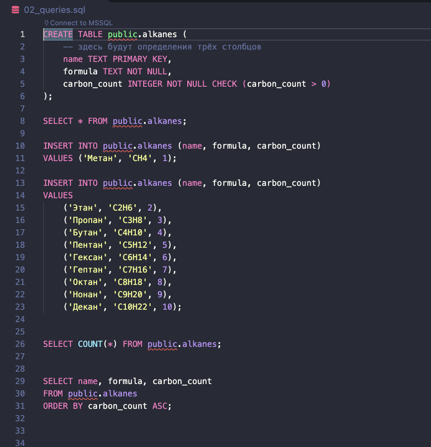
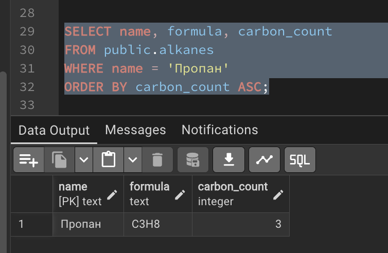
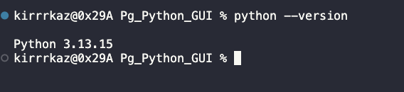
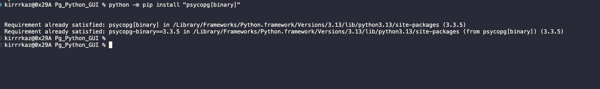
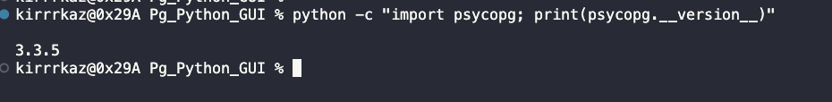
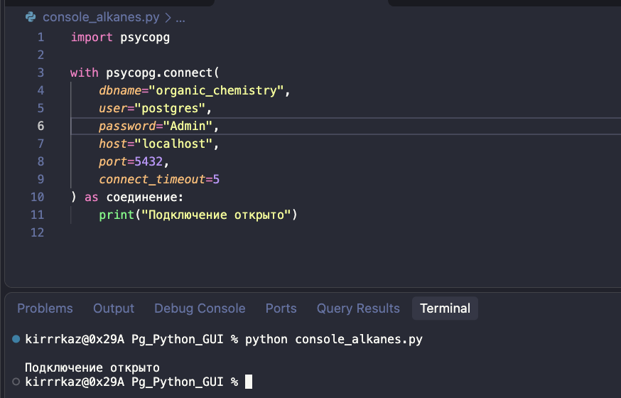
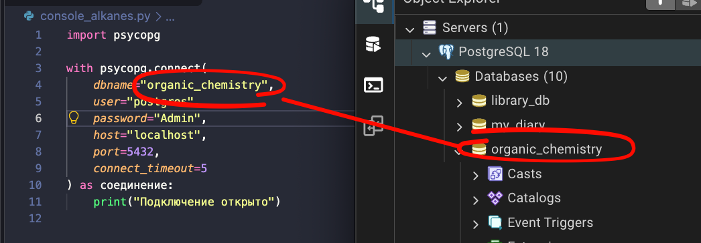
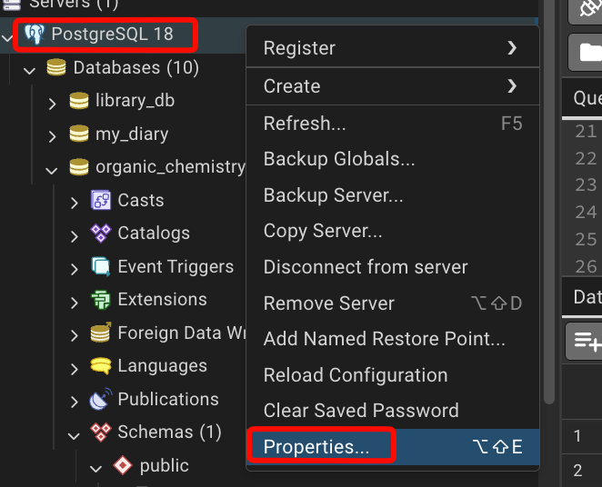
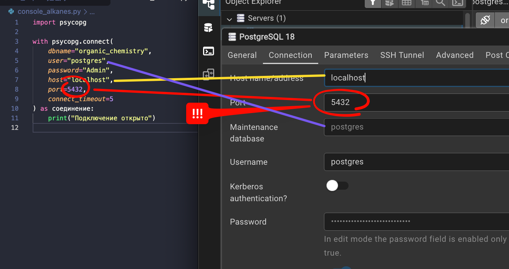

# Занятие 2. Отбираем алканы и выполняем запросы из Python

Продолжение [занятия 1](01_sql_sozdanie_bazy.md). В `organic_chemistry.public.alkanes` должно быть десять строк. Здесь сначала научимся отбирать данные в pgAdmin, затем перенесём знакомый запрос в Python через **Psycopg 3**. Собственные классы не создаём.

## Шаг 1. Вспомните исходную выборку

Откройте Query Tool базы `organic_chemistry`. Введите:

```sql
SELECT name, formula, carbon_count
FROM public.alkanes
ORDER BY carbon_count ASC;
```

У запроса три части: **что получить → откуда → как упорядочить**. Результат — десять строк от метана до декана. Дальше не создаём новые таблицы: изменяем только запрос чтения.

Сохраняйте SQL запросы в `02_queries.sql` (ctrl + S). Создайте папку `alkanes_project` и откройте её в редакторе и поместите в неё данынй скрипт.


## Пример для демонстарции преподавателю SQL запросов:




## Шаг 2. Выведите одно вещество по названию

**Сначала предположите результат:** сколько строк останется, если нужно только вещество с названием «Пропан»?

В исходном запросе **между `FROM` и `ORDER BY`** добавьте условие:

```sql
WHERE name = 'Пропан'
```

Собранный запрос:

```sql
SELECT name, formula, carbon_count
FROM public.alkanes
WHERE name = 'Пропан'
ORDER BY carbon_count ASC;
```

`WHERE` отбирает строки; `=` проверяет равенство. Ожидается `Пропан | C3H8 | 3`.



**Попробуйте сами:** найдите метан. Поменяйте только значение в кавычках. Результат — одна строка `Метан | CH4 | 1`.

## Шаг 3. Замените равенство сравнением чисел

**Замените строку `WHERE`**, остальные части запроса оставьте:

```sql
WHERE carbon_count <= 4
```

Сначала назовите вещества, которые должны попасть в результат. Затем выполните запрос.

**Проверка:** метан, этан, пропан, бутан — четыре строки. `<=` означает «меньше или равно»; `>` — «больше», `>=` — «больше или равно».

**Самостоятельно:** получите вещества, у которых больше 7 атомов углерода. Ожидаются октан, нонан и декан. Не добавляйте вторую строку `WHERE`: замените прежнюю.

## Шаг 4. Объедините два условия

Задача: от 3 до 6 атомов углерода включительно. Замените условие на:

```sql
WHERE carbon_count >= 3 AND carbon_count <= 6
```

`AND` требует выполнения обоих условий. Ожидаются пропан, бутан, пентан, гексан.

Короткая запись той же границы:

```sql
WHERE carbon_count BETWEEN 3 AND 6
```

`BETWEEN` включает оба конца диапазона. Выполните оба варианта по очереди и сравните строки.

**Подумайте:** почему условие `carbon_count >= 3 OR carbon_count <= 6` выберет все десять строк? Для каждой нашей строки выполнится хотя бы одна из этих частей.

## Шаг 5. Измените сортировку

Сохраните диапазон 3–6 и **замените только последнюю строку**:

```sql
ORDER BY carbon_count DESC;
```

**Проверка:** гексан, пентан, бутан, пропан. `DESC` — по убыванию, `ASC` — по возрастанию. Если направление не указано, применяется `ASC`.

Теперь удалите `WHERE` и замените последнюю строку на `ORDER BY name ASC;`. Получится сортировка текста с учётом настроек сортировки БД. У числового и текстового столбца разный смысл порядка. Для порядка в гомологическом ряду сортируйте по `carbon_count`, а не по строке `formula`.

## Шаг 6. Закрепите запросы без готового решения

Для каждой задачи сначала запишите ожидаемые названия, затем составьте запрос:

1. Вывести название и формулу бутана, без третьего столбца.
2. Вывести все три столбца для числа атомов от 5 до 8, по возрастанию.
3. Вывести все три столбца для числа атомов не меньше 8, по убыванию.
4. Найти вещество по формуле `C2H6`.
5. Найти вещества, у которых больше 20 атомов углерода.

Самопроверка: 1 — бутан; 2 — пентан, гексан, гептан, октан; 3 — декан, нонан, октан; 4 — этан; 5 — пустой результат. Пустая выборка сама по себе не означает ошибку.

## Шаг 7. Подготовьте Python

В терминале `alkanes_project` папки проверьте Python:

```bash
python --version
```




Если на вашем компьютере команда называется `python3`, используйте `python3` вместо `python` во всех командах курса. Не смешивайте разные интерпретаторы.

Установите Psycopg 3 в тот Python, которым будете запускать файлы:

```bash
python -m pip install "psycopg[binary]"
```




Отдельное виртуальное окружение в этом учебном маршруте не требуется, как и в исходном разговоре. Если установленный Python запрещает системную установку пакетов, используйте настроенный преподавателем интерпретатор; не обходите ограничение принудительными ключами.

Проверка:

```bash
python -c "import psycopg; print(psycopg.__version__)"
```



Версия должна начинаться с `3.`. Устанавливается пакет `psycopg`, а не `psycopg3` и не `psycopg2`.

`python -m pip` запускает модуль установки библиотек. Команда `python pip` пыталась бы открыть файл с именем `pip`.

## Шаг 8. Создайте первое подключение

Создайте файл `console_alkanes.py` в папке проекта. Начните с импорта:

```python
import psycopg
```

**Под импортом** напишите блок подключения:

```python
with psycopg.connect(
    dbname="organic_chemistry",
    user="postgres",
    password="ВАШ_ПАРОЛЬ",
    host="localhost",
    port=5432,
    connect_timeout=5
) as соединение:
    print("Подключение открыто")
```

Замените `ВАШ_ПАРОЛЬ` своим паролем PostgreSQL, а `user` и `port` — своими значениями, если они отличаются. Это учебный локальный файл; не отправляйте файл с настоящим паролем другим людям.

`localhost` означает сервер на этом компьютере; `connect_timeout` ограничивает время ожидания установки подключения в секундах. pgAdmin может быть закрыт, сервер PostgreSQL должен работать.

Запустите в терминале:

```bash
python console_alkanes.py
```

**Проверка:** сообщение «Подключение открыто». Пока запросов к таблице нет.









## Шаг 9. Вместо проверочной печати выполните SQL

Найдите строку `print("Подключение открыто")`. **Удалите её и на её месте**, с тем же начальным отступом, добавьте:

```python
    with соединение.cursor() as курсор:
        курсор.execute("""
            SELECT name, formula, carbon_count
            FROM public.alkanes
            ORDER BY carbon_count ASC
        """)
        алканы = курсор.fetchall()
```

`cursor()` создаёт объект, через который отправляем запрос. `execute()` выполняет SQL, `fetchall()` забирает строки результата в Python. Тройные кавычки позволяют записать SQL на нескольких строках.

**После обоих блоков `with`, без отступа**, добавьте:

```python
print(алканы)
```

Запустите файл. Начало результата будет таким:

```text
[('Метан', 'CH4', 1), ('Этан', 'C2H6', 2), ...]
```

Многоточие здесь сокращает показ десяти строк, его не нужно вводить в код. `алканы` — список, одна запись — кортеж. Выход из `with` закрывает курсор и соединение; уже полученный список остаётся доступным.

## Шаг 10. Выведите понятные строки через переменные

Замените `print(алканы)` внизу файла циклом:

```python
for алкан in алканы:
    название = алкан[0]
    формула = алкан[1]
    число_атомов = алкан[2]
    print(название, формула, число_атомов)
```

Индексы начинаются с нуля. Их смысл определяется порядком столбцов в `SELECT`: сначала `name`, затем `formula`, затем `carbon_count`. Поэтому дальше используем явное перечисление столбцов вместо `SELECT *`.

**Проверка:** десять отдельных строк, последняя — `Декан C10H22 10`.

## Шаг 11. Передайте условие из Python

Сначала замените только `execute(...)` внутри курсора:

```python
        курсор.execute("""
            SELECT name, formula, carbon_count
            FROM public.alkanes
            WHERE carbon_count >= %s
            ORDER BY carbon_count ASC
        """, (5,))
```

`%s` — место для значения. `(5,)` — кортеж из одного элемента; запятая обязательна. В Psycopg параметры передаются вторым аргументом, без кавычек вокруг `%s` и без подстановки через f-строку. В Query Tool такой маркер не используется: там ранее писали само число.

**Проверка:** шесть строк от пентана до декана. `fetchall()` и цикл менять не нужно.

Теперь **перед внешним `with psycopg.connect(...)`**, без отступа, добавьте:

```python
минимум = 7
```

И замените `(5,)` на `(минимум,)`. Ожидаются четыре строки от гептана до декана.

## Контрольный вариант файла после шага 11

Сначала соберите программу самостоятельно. Этот вариант предназначен для поиска пропущенных строк и ошибок отступов.

```python
import psycopg

минимум = 7

with psycopg.connect(
    dbname="organic_chemistry",
    user="postgres",
    password="ВАШ_ПАРОЛЬ",
    host="localhost",
    port=5432,
    connect_timeout=5
) as соединение:
    with соединение.cursor() as курсор:
        курсор.execute("""
            SELECT name, formula, carbon_count
            FROM public.alkanes
            WHERE carbon_count >= %s
            ORDER BY carbon_count ASC
        """, (минимум,))
        алканы = курсор.fetchall()

for алкан in алканы:
    название = алкан[0]
    формула = алкан[1]
    число_атомов = алкан[2]
    print(название, формула, число_атомов)
```

## Диагностика и итог

- `ModuleNotFoundError: psycopg` — пакет установлен в другой Python или не установлен. Проверьте интерпретатор редактора и команду запуска.
- `password authentication failed` — проверьте пользователя и пароль PostgreSQL.
- `connection refused` — проверьте запуск сервера, адрес и порт.
- `relation ... does not exist` — проверьте базу в `dbname` и выполнение занятия 1.
- `IndentationError` — сверяйте уровни: курсор внутри соединения, запрос внутри курсора, цикл печати после соединения.

Объясните различие между SQL-фильтром и Python-циклом: первый выбирает строки на сервере, второй обрабатывает уже полученные записи.

Далее — [занятие 3: окно с ручными данными](03_tkinter_vruchnuyu.md).

Справка по подключению, курсору и параметрам: [Psycopg 3 — Basic usage](https://www.psycopg.org/psycopg3/docs/basic/usage.html).
