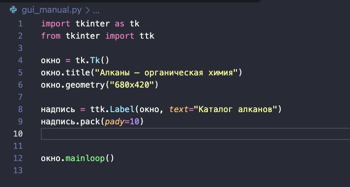
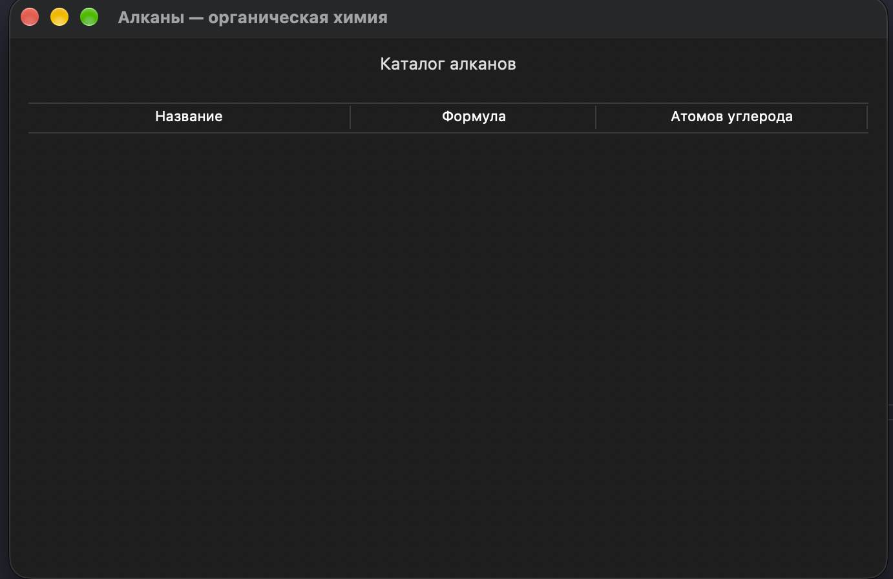

# Занятие 3. Создаём окно Tkinter и заполняем таблицу вручную

После [занятия 2](02_zaprosy_i_python.md) временно отложим подключение к базе. Сейчас изучаем только интерфейс: одно окно, надпись, таблица с тремя столбцами и кнопка очистки. Программа работает без PostgreSQL и без Psycopg.

Пишем обычный последовательный код и функции, без собственных классов. Встроенные объекты Tkinter используем как готовые инструменты.

## Шаг 1. Проверьте Tkinter

В терминале выполните:

```bash
python -m tkinter
```

Должно открыться демонстрационное окно. Закройте его. Если в предыдущем занятии использовали `python3`, здесь тоже используйте `python3`.

Если модуль `_tkinter` отсутствует, нужен Python с поддержкой Tcl/Tk. Обратитесь к преподавателю для настройки используемой установки Python; команда `pip install tkinter` не заменяет эту поддержку.

## Шаг 2. Откройте пустое окно

Создайте в папке проекта файл `gui_manual.py`. Напишите только этот код:

```python
import tkinter as tk
from tkinter import ttk

окно = tk.Tk()
окно.title("Алканы — органическая химия")
окно.geometry("680x420")

окно.mainloop()
```

Запуск:

```bash
python gui_manual.py
```

`tk.Tk()` создаёт главное окно; `title()` задаёт заголовок, `geometry()` — начальную ширину и высоту. `mainloop()` запускает обработку событий: окно ждёт действий пользователя.

**Проверка:** появилось пустое окно с правильным заголовком. Закройте его перед следующим запуском.

**Правило дальнейших шагов:** весь код создания виджетов вставляем **до `окно.mainloop()`**. Эта строка остаётся последней. Если написать создание виджета после неё, оно выполнится только после завершения цикла окна.

## Шаг 3. Добавьте надпись

Найдите строку `окно.mainloop()`. **Прямо перед ней** вставьте:

```python
надпись = ttk.Label(окно, text="Каталог алканов")
надпись.pack(pady=10)
```

`Label` показывает текст, `окно` задаёт родителя. Создать виджет и разместить его — разные действия: `pack()` размещает его в окне. `pady=10` добавляет внешние вертикальные отступы.



**Проверка:** надпись появилась вверху. Измените её текст, запустите файл ещё раз и убедитесь, что меняется именно надпись, а не заголовок окна.

## Шаг 4. Создайте пустую таблицу

**После `надпись.pack(...)`, до `mainloop()`** добавьте:

```python
таблица = ttk.Treeview(
    окно,
    columns=("name", "formula", "carbon_count"),
    show="headings",
    height=10
)

таблица.pack(padx=15, pady=10, fill="both", expand=True)
```

- `columns` — внутренние имена трёх столбцов, пока без видимых подписей.
- `show="headings"` — показывать столбцы с заголовками, скрыв служебный столбец дерева.
- `height=10` — желаемая высота области строк, не ограничение числа записей.
- `padx` и `pady` — внешние отступы.
- `expand=True` — выделять виджету дополнительное свободное место.
- `fill="both"` — заполнять выделенную область по ширине и высоте.

**Проверка:** под надписью появилась пустая область таблицы. Растяните окно: область растёт вместе с ним.

**Мини-опыт:** временно замените `expand=True` на `expand=False`. Увеличьте высоту окна и сравните. Затем верните `True`. `expand` выделяет место, `fill` определяет заполнение выделенного места.

## Шаг 5. Подпишите столбцы

Найдите `таблица.pack(...)`. **Перед этой строкой, после завершения `ttk.Treeview(...)`** добавьте:

```python
таблица.heading("name", text="Название")
таблица.heading("formula", text="Формула")
таблица.heading("carbon_count", text="Атомов углерода")
```

Первый аргумент — внутреннее имя из `columns`, `text` — видимый заголовок. Не меняйте внутреннее имя только ради русской подписи.

В том же месте **после заголовков** добавьте ширину и выравнивание:

```python
таблица.column("name", width=220, anchor="w")
таблица.column("formula", width=160, anchor="center")
таблица.column("carbon_count", width=180, anchor="center")
```

`width` — начальная ширина в пикселях; `anchor="w"` выравнивает содержимое влево, `center` — по центру.

**Проверка:** три понятных заголовка. Объясните, почему вызов `heading("название", ...)` не подходит, если в `columns` указано `name`.



## Шаг 6. Добавьте одну ручную строку

**После `таблица.pack(...)`, перед `mainloop()`** напишите:

```python
таблица.insert("", tk.END, values=("Метан", "CH4", 1))
```

Разберём вызов:

- `""` — родитель верхнего уровня; для нашей плоской таблицы строки не вложены друг в друга.
- `tk.END` — добавить в конец.
- `values` — значения ячеек в порядке `columns`: название, формула, число атомов.

**Проверка:** видна одна строка. Пока ни SQL-запросов, ни подключений нет: значения буквально написаны в программе.

## Шаг 7. Добавьте ещё две строки самостоятельно

Под строкой метана напишите аналогичные вызовы для этана и пропана. Вспомните данные из первого занятия. После самостоятельной попытки сравните:

```python
таблица.insert("", tk.END, values=("Этан", "C2H6", 2))
таблица.insert("", tk.END, values=("Пропан", "C3H8", 3))
```

**Проверка:** три строки, в третьем столбце числа 1, 2, 3. Если формула оказалась в столбце названия, проверьте порядок значений в `values`.

**Вопрос:** появится ли бутан в этом окне, если добавить его в PostgreSQL? Пока нет: программа ничего не читает из БД.

## Шаг 8. Напишите функцию очистки

В начале файла **после импортов, перед `окно = tk.Tk()`** добавьте:

```python
def очистить_таблицу():
    for строка in таблица.get_children():
        таблица.delete(строка)
```

`def` определяет действие, но пока не выполняет его. Тело функции имеет отступ четыре пробела; тело цикла — восемь.

`get_children()` без аргументов возвращает внутренние идентификаторы элементов верхнего уровня. В нашей плоской таблице это все строки. Пример: `('I001', 'I002', 'I003')`. Это идентификаторы интерфейса, а не значения столбцов БД. `delete()` удаляет элементы виджета.

Функция обращается к `таблица`, хотя определена раньше её создания. Это допустимо: обращение произойдёт при нажатии кнопки, когда таблица уже создана. Не вызывайте функцию в начале файла.

## Шаг 9. Создайте кнопку

Найдите `надпись.pack(pady=10)`. **Сразу после неё, перед созданием Treeview**, добавьте:

```python
кнопка_очистки = ttk.Button(
    окно,
    text="Очистить таблицу",
    command=очистить_таблицу
)
кнопка_очистки.pack(pady=5)
```

`command` получает функцию **без круглых скобок**. Запись `command=очистить_таблицу()` вызовет действие при создании кнопки, когда в нашей последовательности таблица ещё не существует.

**Проверка:** запустите файл, нажмите кнопку. Строки исчезли, заголовки остались. Повторное нажатие не вызывает ошибку. Закройте и запустите программу снова: три ручные строки вернутся.

Очистка виджета не удаляет данные из PostgreSQL. В этом занятии PostgreSQL вообще не используется.

## Контрольный вариант после шага 9

Сверяйте с ним собранный файл, если результат отличается:

```python
import tkinter as tk
from tkinter import ttk


def очистить_таблицу():
    for строка in таблица.get_children():
        таблица.delete(строка)


окно = tk.Tk()
окно.title("Алканы — органическая химия")
окно.geometry("680x420")

надпись = ttk.Label(окно, text="Каталог алканов")
надпись.pack(pady=10)

кнопка_очистки = ttk.Button(
    окно,
    text="Очистить таблицу",
    command=очистить_таблицу
)
кнопка_очистки.pack(pady=5)

таблица = ttk.Treeview(
    окно,
    columns=("name", "formula", "carbon_count"),
    show="headings",
    height=10
)
таблица.heading("name", text="Название")
таблица.heading("formula", text="Формула")
таблица.heading("carbon_count", text="Атомов углерода")

таблица.column("name", width=220, anchor="w")
таблица.column("formula", width=160, anchor="center")
таблица.column("carbon_count", width=180, anchor="center")

таблица.pack(padx=15, pady=10, fill="both", expand=True)

таблица.insert("", tk.END, values=("Метан", "CH4", 1))
таблица.insert("", tk.END, values=("Этан", "C2H6", 2))
таблица.insert("", tk.END, values=("Пропан", "C3H8", 3))

окно.mainloop()

```

## Перед переходом дальше

Объясните без подсказки, где создаётся окно, где определяются столбцы, где появляются записи и когда выполняется функция очистки. Покажите ровно три строки, которые задают ручное содержимое.

Сохраните `gui_manual.py`. В следующем занятии сделаем его копию и изменим источник данных, сохранив структуру интерфейса.

Далее — [занятие 4](04_tkinter_postgresql.md).

Справка о таблице и её методах: [Python — ttk.Treeview](https://docs.python.org/3/library/tkinter.ttk.html#treeview).
